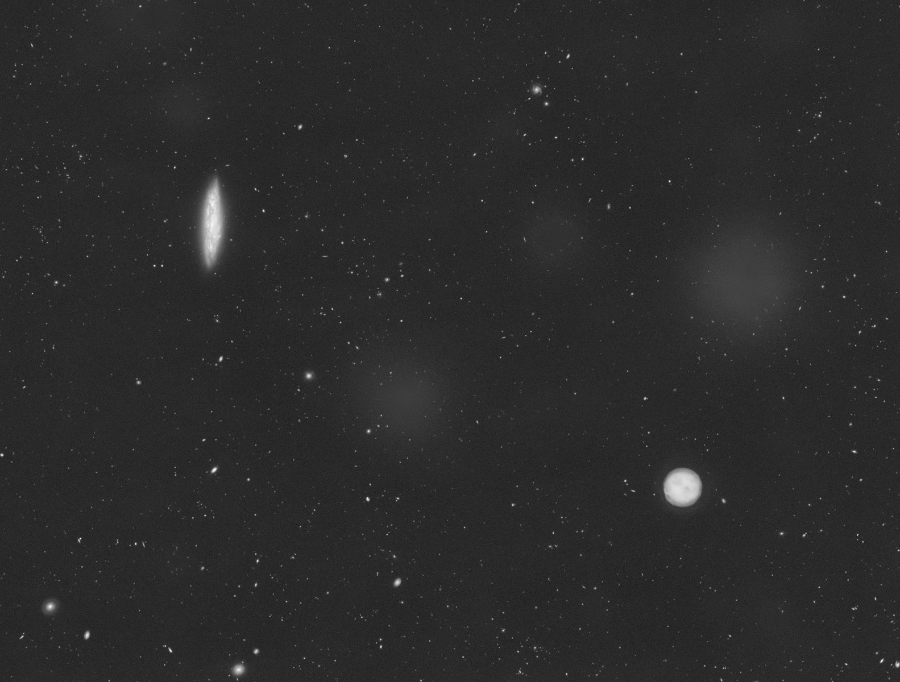

# StellarShield

By **Zachary Eichelberger**

Restores non-stellar objects that star-removal tools take away, specifically galaxies, back into the starless image.

StellarShield checks the star field against the Gaia catalog. It then measures each object's brightness, size and elongation. Objects judged non-stellar are copied back into the starless image through a soft-edged mask, and the stars image is corrected to match.

## Download

StellarShield is a PixInsight script.

| You use | Download | Version |
|---|---|---|
| **PixInsight** | [`StellarShield.js`](StellarShield.js) | 1.3.2 |

## Features

- **Gaia cross-matching** – removed objects are matched against Gaia DR3 or DR3/SP. Objects with no Gaia star, or with too much light or too large a shape for their Gaia star, are judged non-stellar.
- **Round, feathered masks** – restoration masks follow each object's shape, with an adjustable soft edge.
- **Bright star guard** – halos and diffraction spikes of bright stars are kept out of the restoration.
- **Works with original or stars image** – use the original image or the stars-only image. Screened stars images (StarXTerminator's Unscreen Stars) are detected automatically.
- **Live preview** – the whole image at 1/3 resolution. Drag a box to view an area at full resolution, with a before/after toggle.
- **Remembered settings** – settings and image choices are kept between runs, with a **Reset** button.

Works on **linear and stretched (non-linear)** images.

## Requirements

- PixInsight with the Gaia process configured with XPSD database files.
- A plate-solved image (any one of the selected images).

## Installation

Download `StellarShield.js`, then in PixInsight:

1. Choose **Script > Feature Scripts... > Add**.
2. Point it at the folder containing the file and click **Done**.

The script appears under **Script > Utilities > StellarShield**. You can also run it once with **Script > Execute Script File...**.

## Contributing

Bug reports and suggestions are welcome. Please open an issue with:
- your PixInsight and StellarShield version numbers
- the settings you used
- a screenshot, if possible

## License

Released under the [MIT License](LICENSE). © 2026 Zachary Eichelberger.
